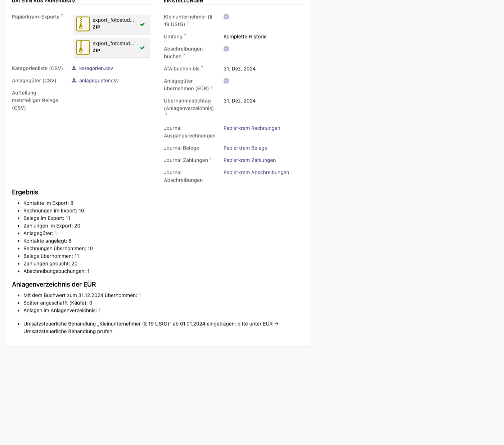
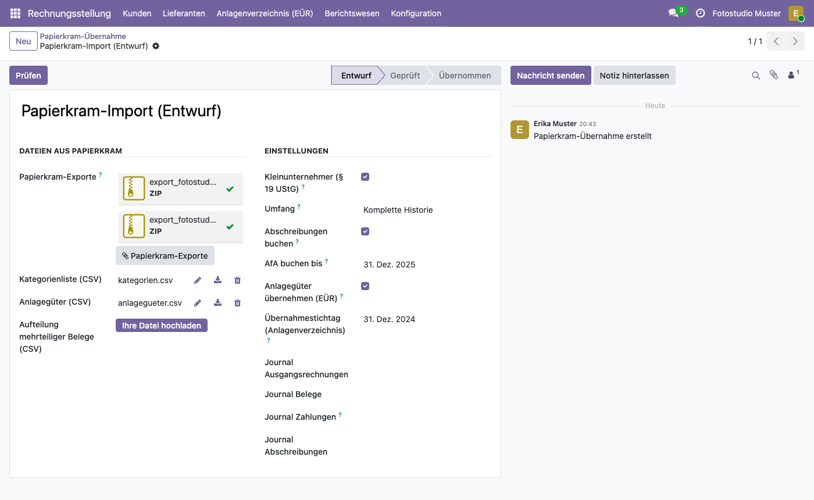
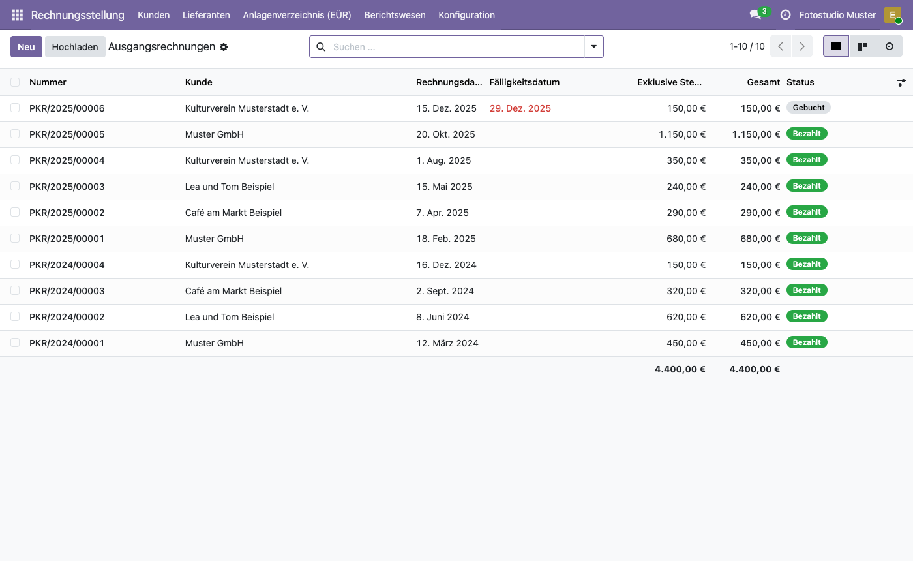
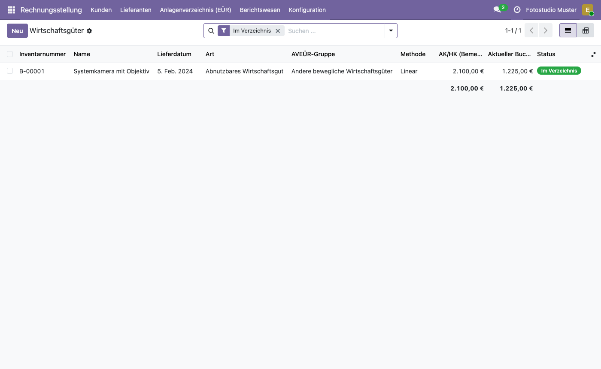

# Papierkram-Import für Odoo
<!-- /!\ Non OCA Context : Set here the badge of your runbot / runboat instance. -->
[](https://github.com/BM1-de/odoo-papierkram-import/actions/workflows/pre-commit.yml?query=branch%3A19.0)
[](https://github.com/BM1-de/odoo-papierkram-import/actions/workflows/test.yml?query=branch%3A19.0)
[](https://codecov.io/gh/BM1-de/odoo-papierkram-import)
<!-- /!\ Non OCA Context : Set here the badge of your translation instance. -->

<!-- /!\ do not modify above this line -->

Von [Papierkram](https://www.papierkram.de) zu Odoo 19 wechseln, ohne etwas abzutippen:
Kontakte, Rechnungen, Gutschriften, Belege, Zahlungen und Anlagegüter – auf Wunsch auch
Produkte, Zeiten und noch nicht abgerechnete Leistungen – kommen direkt aus den
Papierkram-Exporten nach Odoo. Wahlweise die komplette Historie oder nur die offenen
Posten.

> **Alpha:** Die Module sind mit den echten Daten eines Betriebs und mit erfundenen
> Testfällen erprobt, aber noch nicht in vielen Betrieben gelaufen. Ergebnisse nach der
> Übernahme stichprobenartig mit Papierkram vergleichen. Die Software wird ohne
> Gewährleistung bereitgestellt (AGPL-3.0, Abschnitte 15 und 16).



## Die Module

| Modul | Was es übernimmt | Braucht |
| --- | --- | --- |
| `l10n_de_papierkram_import` | Kontakte, Rechnungen und Gutschriften, Belege, Zahlungen, Anlagegüter mit Abschreibungen | `l10n_de` (SKR03 oder SKR04) |
| `l10n_de_papierkram_import_timesheet` | Produkte, Zeiteinträge und noch nicht abgerechnete Leistungen als Aufträge | `sale_timesheet` |
| `l10n_de_papierkram_import_euer` | Anlagegüter direkt ins Anlagenverzeichnis der [Deutschen EÜR für Odoo](https://github.com/BM1-de/odoo-l10n-germany-euer) | `l10n_de_euer` |

Die beiden Zusatzmodule installiert Odoo automatisch, sobald ihre Voraussetzungen da sind.

## Anleitung

### 1. In Papierkram exportieren

- **Pflicht:** *Einstellungen → Export und Import* → für **jedes Jahr** einen Export
  *Vollständig (CSV, PDF)*, auch für das erste. Alle ZIP-Dateien zusammen hochladen: Eine
  Zahlung steht im Export des Jahres, in dem ihr Beleg entstanden ist.
- **Empfohlen:** *Ausgaben → Anlagegüter*, Filter *Alle*, Knopf *CSV* – die Anlagegüter.
- **Empfohlen:** eine Kategorienliste als CSV mit den Spalten `name`, `skr03`,
  `abschreibungsart` und `typ`, also die SKR03-Konten Ihrer Papierkram-Kategorien. Ohne
  sie lassen sich Belege nur übernehmen, wenn alle ihre Kategorien bekannt sind. Ein
  Beispiel liegt im Beispielexport (siehe unten).
- **Nur bei Belegen mit mehreren Kategorien:** eine Aufteilung
  `belegnummer;position;kategorie;betrag_brutto` – der Papierkram-Export enthält den
  Betrag je Kategorie nicht.
- **Für Zeiten:** *Zeiterfassung → Einzelbuchungen*, Filter *Noch nicht abgerechnet* und
  *Gesamter Zeitraum*, Knopf *CSV*.

### 2. Odoo vorbereiten

- Firma mit deutschem Kontenrahmen **SKR03 oder SKR04** (`l10n_de`).
- Die Module in den Addons-Pfad legen und unter *Apps* „Papierkram Import“ installieren.
- **Vor der Übernahme keine Festschreibung** (Sperrdatum) setzen: Odoo würde Buchungen
  eines gesperrten Zeitraums hinter das Sperrdatum verschieben und damit Zahlungsdaten
  ändern.
- Automatisierungen oder Webhooks, die beim Anlegen von Belegen oder Kontakten auslösen,
  laufen auch bei der Übernahme – vorher prüfen und bei Bedarf kurz abschalten.

### 3. Übernahme anlegen

*Rechnungsstellung → Konfiguration → Papierkram-Übernahme → Neu*: die ZIP-Dateien und die
CSV-Dateien hochladen und einstellen:

- **Kleinunternehmer (§ 19 UStG)** ist voreingestellt; ausschalten, wenn der Betrieb in
  Papierkram regelbesteuert war.
- **Umfang:** *Komplette Historie* oder *Nur offene Posten* (unbezahlte Rechnungen und
  Belege mit ihren Teilzahlungen). Eine spätere komplette Übernahme ergänzt den Rest,
  schon übernommene Belege werden übersprungen.
- **Abschreibungen buchen** mit **AfA buchen bis**; mit der EÜR außerdem **Anlagegüter
  übernehmen (EÜR)** zum **Übernahmestichtag (Anlagenverzeichnis)**.
- Mit dem Zeitenmodul die Zeiterfassungs-CSV unter **Nicht abgerechnete Zeiteinträge
  (CSV)**; daraus entsteht je Kunde ein Auftrag, über den sich die Leistungen in Odoo
  abrechnen lassen.

Die Journale *Papierkram Rechnungen*, *Belege*, *Zahlungen* und *Abschreibungen* legt die
Übernahme selbst an, wenn keine vorhandenen gewählt sind.



### 4. Prüfen und übernehmen

1. **Prüfen** liest alle Dateien und schreibt ein Protokoll. Blockierende Hinweise zuerst
   beheben (z. B. eine fehlende Kategorie).
2. **Übernehmen** legt Kontakte und Buchungen an. Die Ergebnisübersicht zählt, was
   übernommen wurde; die Knöpfe oben führen zu den Buchungen und Anlagen.

Jede Buchung behält ihre Papierkram-Nummer, neue Kontakte ihre Kunden- oder
Lieferantennummer (`K-…`, `L-…`) als Referenz. Gibt es einen Kontakt gleichen Namens schon
in der Datenbank, verwendet die Übernahme ihn mit.



### 5. Danach

- Stichproben gegen Papierkram: Summen je Jahr, offene Posten, Anlagegüter.
- Ein übernommener Beleg wird bei einer späteren Übernahme nicht aktualisiert: Zahlungen,
  die Papierkram danach noch erfasst, in Odoo buchen.
- Mit der [Deutschen EÜR für Odoo](https://github.com/BM1-de/odoo-l10n-germany-euer) stehen die
  Anlagegüter mit Buchwert zum Stichtag im Anlagenverzeichnis, und die EÜR des laufenden
  Jahres lässt sich gleich in Odoo rechnen.



## Grenzen

- Rechnungen kommen mit ihren Summen, nicht mit den einzelnen Positionen (die liefert
  Papierkram nicht als CSV); das Original-PDF hängt an der Rechnung.
- Kontoumsätze werden nicht übernommen.
- Regelbesteuerung mit mehreren Steuersätzen in einem Beleg ist noch nicht abgedeckt.

## Ausprobieren ohne eigene Daten

Der Beispielexport eines erfundenen Fotostudios (zwei Jahre, Rechnungen, Belege, Zahlungen
und eine Kamera als Anlagegut) entsteht mit

```bash
python3 -I _dev/werkzeuge/gen_demo_export.py build/demo
```

und lässt sich wie oben beschrieben in einer Testdatenbank übernehmen. Daraus stammen auch
die Screenshots.

## Mehr Dokumentation

Die Beschreibung jedes Moduls (englisch) steht in seinem `README.rst`:
[l10n_de_papierkram_import](l10n_de_papierkram_import/README.rst),
[l10n_de_papierkram_import_timesheet](l10n_de_papierkram_import_timesheet/README.rst),
[l10n_de_papierkram_import_euer](l10n_de_papierkram_import_euer/README.rst).

*English: Move from Papierkram to Odoo 19: contacts, invoices, credit notes, vouchers,
payments and fixed assets, optionally products, time entries and unbilled work, taken over
from the Papierkram exports – the complete history or only the open items. Alpha, no
warranty.*

Papierkram ist eine Marke ihres Inhabers; diese Module sind ein unabhängiges Projekt und
nicht mit Papierkram verbunden.

<!-- /!\ do not modify below this line -->

<!-- prettier-ignore-start -->

[//]: # (addons)

Available addons
----------------
addon | version | maintainers | summary
--- | --- | --- | ---
[l10n_de_papierkram_import](l10n_de_papierkram_import/) | 19.0.1.0.0 | <a href='https://github.com/bm1-phillip'></a> | Import contacts, invoices, vouchers, payments and assets from Papierkram
[l10n_de_papierkram_import_euer](l10n_de_papierkram_import_euer/) | 19.0.1.0.0 | <a href='https://github.com/bm1-phillip'></a> | Take over the fixed assets of Papierkram into the EÜR asset register
[l10n_de_papierkram_import_timesheet](l10n_de_papierkram_import_timesheet/) | 19.0.1.0.0 | <a href='https://github.com/bm1-phillip'></a> | Import products, time entries and unbilled work from Papierkram

[//]: # (end addons)

<!-- prettier-ignore-end -->

## Licenses

This repository is licensed under [AGPL-3.0](LICENSE).

However, each module can have a totally different license, as long as they adhere to Baumgärtner Marketing GmbH
policy. Consult each module's `__manifest__.py` file, which contains a `license` key
that explains its license.

----
<!-- /!\ Non OCA Context : Set here the full description of your organization. -->
